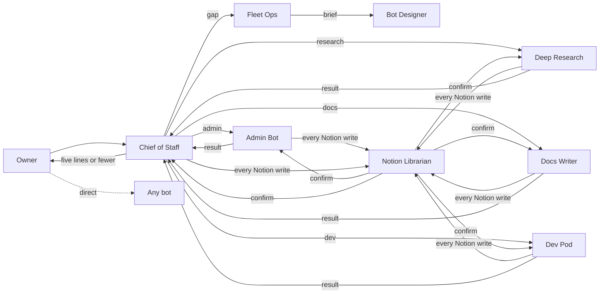

# Grok Bot OS: architecture

A personal fleet of single-job Grok Bots built around one private Notion space. One bot is the front door, one bot is the only Notion writer, and every action that leaves the box goes through an approval gate.

**Personal bots, one owner.** Every bot here is a personal bot for one owner. Never convert one to a Team Bot or share it as a template: these profiles carry personal rules (the personal Notion gate, calendar privacy) that make no sense for a team and could leak private context. A team needs its own bots built without them (see the Team Bot boundary below).

**Adapt, don't copy.** This bundle describes a setup that works for one person. Keep the structure (one job per bot, the front door, the gates, the Notion core) and change everything else to fit your owner: which bots, which tools, which times, which categories. The owner approves each bot before it exists.

## 1. The bots

| Bot | One job | Owns routines |
|---|---|---|
| Chief of Staff | Front door: route work to owners, scan Slack, email, and calendar, write the briefs | What-needs-you brief, daily task review, end-of-day update |
| Notion Librarian | The only Notion writer; keeps the space categorized and findable | None (optional write audit) |
| Admin Bot | Admin execution: scheduling, RSVPs, bookings, email drafts, logistics | None (optional invite watch) |
| Deep Research | Verified, cited answers to work questions | None |
| Docs Writer | Internal, external, and architecture docs | None |
| Dev Pod | Takes a product from goal to shipped increment | None |
| Side Quest | Rabbit holes, kept away from real work | None |
| Fleet Ops | Fleet lifecycle: inventory, gaps, overlaps, proposals | Weekly fleet checkup, daily fleet check-in |
| Bot Designer | Designs and builds bots; reviews every new rule | None |

Profiles are in `profiles/`. Each has a job, voice, anti-jobs, gates, routines, and handoffs.

## 2. Structural rules
- **One job per bot.** Each bot has one job and explicit anti-jobs naming who owns the neighboring work. A new recurring task becomes a skill or a routine on an existing bot before it becomes a new bot.
- **Front door.** Requests that don't obviously belong to one bot go to Chief of Staff, which routes them, checks the result, and reports back in five lines or fewer. It never builds. Unowned work is reported to Fleet Ops as a gap, not absorbed.
- **Chief of Staff priority.** Every message any bot sends to Chief of Staff uses priority true. Chief of Staff alone decides whether the owner is pinged, so there's one filter on the owner's attention.
- **Rule review.** Every new rule is reviewed by Bot Designer for conflicts and wording before it is applied to any bot, and the owner says yes in Bot Designer's chat.
- **Documents go to Notion.** Anything document-shaped lands as a Notion page through Librarian (or in a repo or wiki, for docs and code). A box scratch file is never the deliverable.
- **Narrow triggers.** Routines fire on a schedule or a narrow filter, never "every new message."
- **No security illusion.** All bots share one computer and its logins, so separating bots is not a safety control. Safety comes only from the gates below.
- **Team Bot boundary.** Rules that are personal to the owner (calendar privacy, the personal Notion gate, anything user-specific) go only on the owner's personal bots, never on Team Bots or shareable copies. A Team Bot is built fresh without them; when rolling a personal rule across the fleet, skip Team Bots.

## 3. Front-door flow

The owner can still talk to any bot directly. Side Quest only hands work to Chief of Staff when the owner explicitly asks.

## 4. The Notion core
- Notion holds the to-do list (Tasks), projects, lasting notes, the shared Categories list, research, and the bot rules page (Agent README) with its change log. See `notion/`.
- **Librarian is the only writer.** Every other bot reads freely (search and fetch) but sends every write (create, update, move, comment, property edit, row, delete, trash, restore) to Librarian with the exact content and target. That includes when the owner says "put it in Notion." Until Librarian confirms, the bot says "queued." If a bot notices it wrote directly, it stops, tells the owner, and tells Librarian what it touched.
- **Saved views only.** Bots query databases only through Librarian's saved views (`notion/views.md`), never SQL or rows mode.
- **Tasks is the only to-do list.** Every task has notes (what, why, next step, source). Each task has a Todo type (a relation to the Todo types database); waiting items use "Others' work" with a follow-up date.
- **Deletes need the owner's own yes,** naming the item, in Librarian's chat. Otherwise, archive.
- **No Notion links for coworkers** in Slack or email.
- Every bot reads the Agent README at the start of each session.

## 5. Approval and send gates
- **Owner-only approvals.** Only the owner's own words count. A yes relayed by another bot doesn't (one exception: Chief of Staff relaying an RSVP decision to Admin Bot for one invite).
- **Draft before send.** Every outgoing email or message is a draft card unless the owner says to send it without showing them.
- **Money gate.** Any purchase needs the owner's yes at the moment of purchase.
- **Approvals expire.** An approval card raised by a routine or another bot can expire with nobody watching. Routines stop at a draft and never wait on approval.
- **Calendar privacy.** Personal appointments are private. Out-of-office entries are public with no description. No personal details in any title, description, Slack, email, or other surface coworkers can see.

## 6. Routines
Exactly five core routines, defined in `routines.md`. Two optional add-ons (Admin Bot's invite watch, Librarian's write audit) are listed there separately.

| Routine | Owner | Default schedule |
|---|---|---|
| What-needs-you brief | Chief of Staff | weekdays 8, 12, 16 |
| Daily task review (includes the stale sweep) | Chief of Staff | weekdays at the owner's review block |
| End-of-day update | Chief of Staff | weekdays 17:00 |
| Weekly fleet checkup | Fleet Ops | Mondays 09:00 |
| Daily fleet check-in | Fleet Ops | weekdays 06:45 |

## 7. How bots talk to each other
- Bots message each other by bot ID (`SendToAgent`). Messages arrive on the receiver's next turn; they aren't a live conversation.
- Use priority true only when the receiver must act or is waiting, and always for Chief of Staff.
- The receiver reports status only to the bot that asked; that bot tells the owner. The owner never hears the same thing twice.
- Handoffs name the role and the ID: `{{BOT_ID:Role}}`.

---

## 8. Install (written to the installing bot)

You are setting this up for your owner, {{OWNER_NAME}}. Go one step at a time and get the owner's yes before each step that creates something. Adapt as you go: ask what they actually use, and drop or rename anything that doesn't fit. These are personal bots for this one owner; never make any of them a Team Bot or share them as templates.

**Prerequisite: Notion write access.** You must have Notion connected with write access before you start. It's a requirement of the install, and step 0 checks it.
Having write access doesn't mean you use it: during the install you only read Notion. Notion Librarian does every Notion write, from step 3 on.

**Step 0. Check Notion, then fill in the placeholders.** First confirm Notion is connected for you with write access: a Notion search works, and your Notion tools include creating and updating pages. If either check fails, stop and tell the owner: "Notion isn't connected with write access, so I can't install Grok Bot OS yet. Connect Notion with write access for me, then tell me to continue." Don't go on to step 1 until it passes. Then ask the owner for:
- `{{OWNER_NAME}}`, `{{TIMEZONE}}`, `{{COMPANY}}`
- `{{WORK_CALENDAR}}` and `{{PERSONAL_CALENDAR}}`
- `{{INTERNAL_SOURCES}}`, `{{EXTRA_SOURCES}}`
- Docs: `{{INTERNAL_WIKI}}`, `{{DOC_HOME_A}}`, `{{DOC_HOME_B}}`, `{{DOC_HOME_C}}`, `{{PROSE_AUDIT_SKILL}}`
- Which bots they want (not everyone needs Dev Pod, Docs Writer, or Side Quest), and for Dev Pod, the first product name, which sets `{{VIEW:<product> Backlog}}` and `{{VIEW:<product> Delivery}}`.
`{{BOT_ID:Role}}` and the other `{{VIEW:...}}` placeholders are filled as the bots and views are created.

**Step 1. Create Bot Designer.** With the owner's approval, create Bot Designer from `profiles/bot-designer.md`.

**Step 2. Bot Designer creates Notion Librarian** from `profiles/notion-librarian.md`, after asking the owner its design questions and getting the owner's yes in its own chat. From here on, every Notion write in this install is Librarian's.

**Step 3. Librarian builds Notion.** Send Librarian `notion/` and ask it to build, confirming each part with the owner:

*Notion schema: full detail is in `notion/schema.md`, `notion/views.md`, and `notion/page-tree.md`.*

1. The top-level pages from `notion/page-tree.md`: Personal, Tasks, Inbox, Workstreams, Domains, Operating system, Reference, Archive.
2. Under Operating system, the databases in this order, so relations have targets: **Categories**, **Todo types**, **Projects**, **Notes**, then **Tasks** (at the top of the sidebar), with the properties, types, and option sets in `notion/schema.md`.
3. The relations: Tasks.Project → Projects, Tasks.Category → Categories (multi), Tasks.Todo type → Todo types (two-way), Notes.Category → Categories (multi), Notes.Related Project → Projects. Confirm the back-links appear.
4. **Seed Categories** from `notion/categories-seed.csv` after the owner edits it, and **seed Todo types** from `notion/todo-types-seed.csv` (six rows; Owned is checked only for Do / own).
5. The Agent README page under Operating system with the sections in `notion/page-tree.md`, and its inline **Agent change log** database.
6. Under Reference: Research and Architecture Reference. Put a copy of this architecture document in Architecture Reference.
7. If the owner wants Dev Pod: under Domains, the Dev sandbox, `_Shared conventions`, Products, `_Template product`, and the first product with its Backlog and Delivery databases.
8. **The saved views** in `notion/views.md`, exactly as specified, plus a Backlog and a Delivery view for each Dev Pod product. Librarian reports each view's reference so it can replace `{{VIEW:...}}` in the profiles.
Project-only databases (Meeting notes, Work board) come later, inside a project page, only when a project needs them.

**Step 4. Bot Designer creates the rest of the bots** from `profiles/`, in this order: Chief of Staff, Fleet Ops, Admin Bot, Deep Research, then whichever of Docs Writer, Dev Pod, and Side Quest the owner wants. For each one:
- Bot Designer asks the owner its design questions (at most three) in its own chat.
- The owner approves that bot before it is created. No bot is created on a relayed yes.
- Bot Designer reads the saved profile back to confirm it matches, then fills `{{BOT_ID:Role}}` and `{{VIEW:...}}` placeholders in every profile that names it (part of the approved create; no re-ask).

**Step 5. Add the routines.** Each owning bot creates its own routines from `routines.md` (a bot edits only its own): the five core routines, plus any optional add-on the owner wants. Set `{{TIMEZONE}}`, adjust times with the owner, and leave each one draft-only.

**Step 6. You, after install.** Either become Bot Designer (if you were created to be it), or add the canonical Notion gate block from any profile in `profiles/` to your own profile now, so your later Notion writes go through Librarian like every other bot's.

**Step 7. Verify.** Check each item and report pass or fail to the owner:
- [ ] Every database in `notion/schema.md` exists with its properties, option sets, and relations, including Todo types and the two-way Todo type relation.
- [ ] Categories is seeded with the owner's edited list; Todo types has its six rows with definitions, and only Do / own is Owned.
- [ ] Each bot view returns the right rows, sort, and columns (Waiting on others shows only Todo type Others' work).
- [ ] The Agent README and its change log exist.
- [ ] Every bot exists, the owner approved each one, its saved profile was read back, and no `{{...}}` placeholder is left.
- [ ] No bot is a Team Bot, and none has been shared or published as a template.
- [ ] Notion gate: ask Chief of Staff to add a test task. It sends the task to Librarian and says "queued"; Librarian creates it with notes and a Todo type and logs it in the change log.
- [ ] Delete gate: ask Chief of Staff to trash that test page. It routes to Librarian, and Librarian refuses without the owner's own yes in Librarian's chat.
- [ ] Clean-up: the test task is archived by Librarian, not by you.
- [ ] Front door: ask Chief of Staff for something admin-shaped. It routes to Admin Bot and reports back in five lines or fewer.
- [ ] Draft before send: ask Admin Bot to email someone. It produces a draft card and doesn't send.
- [ ] The stale sweep runs as part of the daily task review (run it once by hand), and the brief doesn't run its own sweep.
- [ ] Exactly five core routines exist on their owning bots (plus any chosen add-on), in the right time zone, each stopping at a draft.
- [ ] Fleet Ops runs a first checkup and reports keep / update / create / prune, or stays quiet.
